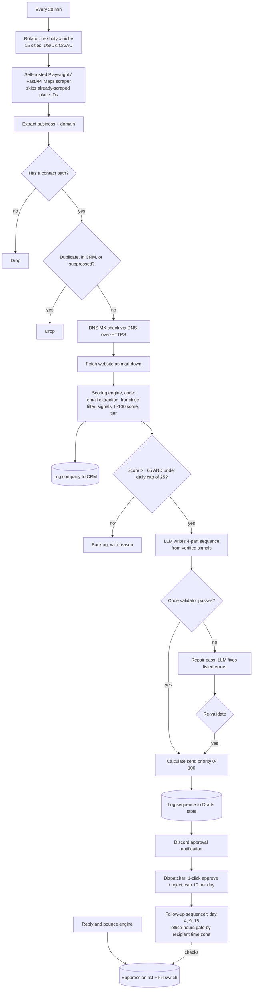

# Case Study: Autonomous Lead Generation and Outreach Engine

**A self-hosted n8n system that finds local businesses, decides which are worth contacting before spending a cent on AI, drafts outreach that is checked by code before a human ever sees it, and runs the follow-up sequence and reply handling.**

    

| | |
|---|---|
| **Type** | Personal build, self-hosted on my own cloud server. Built to prospect for my own services. |
| **My role** | Sole designer and builder: scraping service customisation, scoring model, prompt and validation design, sequencing, safety controls |
| **Scale** | 5 workflows. The lead engine is 33 nodes; 4 outreach workflows (review, follow-up, replies, inbound) |
| **Stack** | n8n, Playwright + FastAPI (self-hosted Maps scraper), Airtable, Discord, Gmail SMTP, an OpenAI-compatible LLM endpoint, OpenRouter, Jina reader, DNS over HTTPS |
| **Status** | The lead engine is built and has run in test executions. **It has not been run on real prospects and I have sent nothing.** Two parts of the outreach half are still placeholders, marked below. |

---

## The problem

Finding clients is the part of freelancing nobody wants to do and everybody has to. Doing it by hand is slow; doing it with a naive scraper plus ChatGPT produces spam: duplicates, dead addresses, generic emails to businesses that were never a fit, and a model bill that grows with every lead whether it deserves it or not.

A good prospecting system has to do four things most "AI outreach" tools skip: **filter hard before spending money, write only from facts it actually found, keep a human in control of every send, and make stopping easy.**

## What it does

- Finds local businesses on a schedule, one city and niche at a time, through a **scraper I host myself**.
- Throws away duplicates, already-contacted companies and anything on the suppression list, then checks that the domain can actually receive mail.
- Reads each company's website, extracts **verifiable signals**, and scores the lead 0-100 with deterministic code.
- Only leads above the score floor, and only up to a **daily cap**, ever reach the LLM.
- The model writes a four-part sequence from a menu of detected facts. **Code then validates the draft** and triggers an automatic repair pass if it fails.
- A human approves or rejects from Discord. Follow-ups respect the recipient's office hours. Replies and bounces feed a suppression list and a kill switch.

---

## Architecture



### Stage by stage

| # | Stage | What it does | Why it is built this way |
|---|---|---|---|
| 1 | **Rotator** | Advances a persistent counter through every city and niche combination; the niche list depends on the service being sold. | Coverage without repeating, and it survives restarts because the counter is stored workflow state. |
| 2 | **Scraper service** | A Playwright/FastAPI service I customised from an open-source scraper so it accepts a list of place IDs to skip. | Without it, every run re-scrapes places already processed, wasting time and risking blocks. |
| 3 | **Filters** | Contact path required; duplicates checked against the CRM, a running seen-list and the suppression list; DNS MX lookup confirms the domain accepts mail. | All free. They remove the leads that cannot succeed before anything costs money. |
| 4 | **Website signals and scoring** | Fetches the site as markdown and runs a code scoring engine (details below). | Deterministic, explainable, cheap, and tunable without touching a prompt. |
| 5 | **Cap and gate** | Score of at least 65 and fewer than 25 drafts today. Everything else is parked as backlog with the reason. | A hard ceiling on model spend and on daily volume. |
| 6 | **Drafting** | The model returns a strict JSON object: a chosen signal, the evidence for it, a proof point, a subject, an email and three follow-ups. | Forces the model to ground the email in something real. |
| 7 | **Validate and repair** | Code checks the draft; on failure a second LLM call receives the list of errors and fixes them; the result is validated again. | Models drift. A loop that measures and corrects beats a longer prompt. |
| 8 | **Prioritise and log** | Computes a send priority and writes the company and the whole sequence to Airtable. | The human reviews the best leads first. |
| 9 | **Review** | Discord approve/reject links. A dispatcher enforces a cap of 10 per day on weekdays. | Nothing is sent without a person saying yes. |
| 10 | **Follow-ups** | A sequencer sends touches on day 4, 9 and 15, only during office hours in the recipient's US time zone, and checks the kill switch first. | Polite timing and an emergency stop. |

---

## Deep dives

### The scoring engine is code on purpose

The score comes from a Code node, not a model. It extracts an email from the page (preferring a named, direct address over generic ones like `info@` or `contact@`), strips legal suffixes from the business name, rejects national franchises by name, and adds weighted points for observable signals that suggest an automation gap, for example a detected CRM or automation platform, a manual contact form with no connected CRM, a booking calendar, high review volume, active hiring, and the lack of social presence. Each contributing signal is recorded as a `gapSignal`, so every score is explainable. Leads become **Tier A (80 and above)** or **Tier B (65 to 79)**; below 65 they are parked.

Why code instead of an LLM: it is free, fast, repeatable, and when it is wrong I can see which rule to change.

### Grounded drafting

The drafting prompt does not say "write a good email". It supplies a *menu* of verified signals and a list of proof points, and requires this output:

```jsonc
{
  "chosen_signal": "key of a signal from the menu (e.g. booking_flow, intake_form, tech_crm)",
  "hook_evidence": "the exact fact used in paragraph 1",
  "proof_used":    "the proof point used in paragraph 2",
  "subject":       "3 to 8 words, lowercase",
  "email_1":       "initial 3-paragraph email",
  "followup_1":    "day 4",
  "followup_2":    "day 9",
  "followup_3":    "day 15"
}
```

The prompt carries a hard-rule list: first person, one fixed way to introduce myself, no dashes, no exclamation marks, no emojis, a banned-words list (the clichés of cold email), and the CTA offers a small, concrete piece of work rather than a call.

### The validator and the repair loop

After drafting, a Code node checks the result, and the checks are mechanical:

- All eight keys present and non-empty.
- `chosen_signal` must be one of the signals actually detected for this business. The model cannot cite a fact the scraper did not see.
- Word-count bounds for every email, a 3 to 8 word lowercase subject.
- No em or en dashes, no exclamation marks.
- No agency language ("our", "we build...") because the sender is one person.

On failure, a second LLM call receives the draft plus the list of errors and is asked to fix exactly those; the result is validated again. This turns "the model usually follows the rules" into "output that reaches a human has been mechanically checked".

### Send priority

Reviewing everything equally wastes the reviewer's time, so each approved-quality draft gets a 0-100 priority: roughly a third from the fit score, plus points for a direct (rather than generic) address, plus points for how strong the chosen hook is, plus a small bonus for a verified mail server; minus penalties for needing review, for markets I am less able to serve, and for very large businesses likely to ignore a cold email.

### Safety and etiquette

- **Kill switch:** the sequencer checks a shared endpoint before sending; the reply engine can trip it when a bounce is detected.
- **Office hours:** touches only go out in the recipient's local business hours, by US time zone.
- **Opt-out line:** every email ends with a simple way to say no.
- **Caps everywhere:** 25 drafts per day at generation, 10 sends per day at the dispatcher.

---

## Decision log

### Decision 1: score with code, draft with a model
- Scoring runs on every lead; drafting only on the best. Putting the cheap, explainable step first means model spend tracks lead quality. Cost: the scoring heuristics are proxies and need calibration against real replies (see gaps).

### Decision 2: a menu of verified signals instead of free-form personalisation
- It makes hallucinated flattery impossible to ship, because the validator rejects it. Cost: emails are limited to what the scraper can detect.

### Decision 3: validate and repair instead of one perfect prompt
- Two cheap passes with a measurable check beat an ever-longer prompt. Cost: occasionally a second model call.

### Decision 4: host the scraper myself
- Control over rate and a modification the off-the-shelf tool lacked (skip already-scraped places). Cost: I run and maintain a service, and scraping Maps carries terms-of-service risk, which is why interval and result caps are conservative.

### Decision 5: human approval and a kill switch before any sending feature
- Reputation damage from a bad send is permanent; a missing feature is not.

---

## Failure modes I designed for

| What goes wrong | What happens |
|---|---|
| Same business scraped twice | Skipped by place ID at the scraper, then by domain against the CRM and seen-list |
| Domain cannot receive mail | Dropped at the MX check |
| National franchise | Excluded by the scoring engine |
| Model breaks a formatting or content rule | Validator fails the draft; repair pass runs; re-validated |
| Model cites a signal that was not detected | Rejected by the validator |
| Daily draft cap reached | Lead parked as backlog with the reason |
| Bounce detected | Address suppressed and the kill switch can pause sending |

## Where it stands

I built this to prospect for myself.

**Built and exercised in test runs (none against real prospects):** the full lead engine (rotation, scraping integration, filtering, scoring, grounded drafting, validate-and-repair, logging, Discord notification), the follow-up sequencer's logic and the inbound contact webhook.

**Not yet true:**
- **Not run on real prospects, no email has been sent.** There are no reply rates or conversion figures, and I will not make any up.
- **The dispatcher's final send step is a placeholder.** It returns "ready to dispatch" and sends nothing. A real send must be wired (Gmail draft-first is the plan) before activating it.
- **The reply engine's inbox fetch is a placeholder.** The classification and bounce logic exist; the part that reads the mailbox does not.
- **The scoring weights are educated guesses.** They need calibrating against real replies.

## What I would fix next

Real defects from auditing my own system, in order:

1. **Mark a lead "seen" only after the CRM write succeeds.** Today a failed write can lose the lead permanently. (About a fifth of historical test runs errored, which is how I found it.)
2. **Do not discard leads with no homepage email.** Check `/contact`, `/about` and `/team`, and park the rest as "no email yet" instead of suppressing them.
3. **Fix domain extraction for builder-hosted sites.** Some Wix- and Squarespace-style URLs produce an empty domain and the lead is dropped.
4. **Replace the MX-only "verified" with a real mailbox check** before any send. MX proves a domain takes mail, not that a person exists.
5. **Route opt-outs into the suppression table.** The reply classifier detects a hard "no" but only posts it to Discord; today only bounces are suppressed. This is the most important fix before any sending.
6. **One shared daily cap and one shared kill switch** across the dispatcher and sequencer, which currently keep separate counters.
7. **Signed review links.** Approve/reject are plain GET links, so a link preview or crawler could trigger them. Use a signed token and a confirmation page.
8. **Attach the error workflow to every workflow** and read the messages from the failed runs.
9. **Use one sender identity and postal address** everywhere; two footers disagree.
10. **Calibrate scoring against replies** once there are any.

## Configuration and swap-ins

Everything below is a setting or a node swap, not a rewrite. The defaults are what I used because they are free or cheapest, not because the design needs them.

| What | Default here | Change it to |
|---|---|---|
| **Drafting LLM** | A free-tier NVIDIA-hosted model through an OpenAI-compatible node, used for both the draft and the repair pass | Any OpenAI-compatible endpoint, OpenAI, Anthropic, Gemini, or a local model. The validator makes weaker models usable and stronger ones need fewer repairs. A second provider can be added as a fallback. |
| **Daily draft cap** | 25 | Any number, or monthly caps per tier. It is one value in the cap node. |
| **Tier thresholds** | Tier A at 80, Tier B at 65, below 65 parked | Any. |
| **Scoring weights and signals** | Gap signals such as CRM detected, manual form, booking calendar, review volume, hiring | Add, remove or reweight signals for your own offer. |
| **Cities and niches** | 15 cities, role-specific niche lists in the rotator | Edit the two arrays. |
| **Offer, voice and proof points** | My services and writing style in the Config node | Your own. This is the part that makes it yours. |
| **Scraper** | Self-hosted Playwright/FastAPI service | Apify, Outscraper, SerpAPI, Google Places API, a purchased list. Anything that returns name, website and place ID. |
| **Review and notification channel** | Discord | Slack, email or Telegram. |
| **Sender** | Gmail SMTP | Any SMTP or API sender. |
| **Dispatcher cap, cadence, office hours** | 10 per day, day 4/9/15, US time zones | Any. |
| **CRM** | Airtable | Sheets, Notion, Postgres, HubSpot. |

## What this demonstrates

- **Cost-aware pipeline design**: free filters, deterministic scoring, then a capped LLM step.
- **Guard-railed LLM output**: grounding, mechanical validation and an automatic repair loop.
- **Backend integration**: customising and self-hosting an open-source scraper service and wiring it to n8n.
- **Safe-by-default outreach**: approval gate, caps, office-hours gating, suppression and a kill switch.
- **Production-minded self-criticism**: an explicit status and a prioritised defect list.

## Repository

| File | Purpose |
|---|---|
| [`workflows/01-lead-engine-and-outreach-crm.json`](workflows/01-lead-engine-and-outreach-crm.json) | Rotate, scrape, filter, score, draft, validate, log (33 nodes) |
| [`workflows/02-dispatcher-discord-review.json`](workflows/02-dispatcher-discord-review.json) | Review queue, 1-click Discord approve/reject, daily cap. Send step is a placeholder |
| [`workflows/03-multi-touch-followup-sequencer.json`](workflows/03-multi-touch-followup-sequencer.json) | Day 4/9/15 follow-ups, office-hours gate, kill-switch check |
| [`workflows/04-reply-and-bounce-engine.json`](workflows/04-reply-and-bounce-engine.json) | Reply intent, bounce suppression. Inbox fetch is a placeholder |
| [`workflows/05-portfolio-inbound-triage.json`](workflows/05-portfolio-inbound-triage.json) | Inbound contact webhook, CRM match, alert |

### Run it yourself
1. Import the workflows into n8n. All are exported **inactive**.
2. Replace every placeholder (`REPLACE_ME`, `YOUR_*`, `WORKFLOW_ID_*`) and re-select credentials. The Config node holds the sender profile, daily cap and Airtable table names; set your own sender identity and postal address.
3. Deploy the Maps scraper service and point the HTTP node at it (host names in the export are internal Docker names).
4. Create the Airtable tables (companies/CRM, outreach drafts, suppression).
5. Keep everything **inactive** until you have tested with your own addresses.

### Responsible use
Scraping Google Maps may violate Google's terms, and cold email is regulated. Keep interval and result caps low, honour opt-outs, include a real postal address, and check CAN-SPAM, GDPR and PECR for your jurisdiction. This documents a pipeline design; it is not an invitation to send unsolicited bulk mail.

MIT licensed.

*Built by Laurence. Part of a set of four automation case studies: [incident platform](https://github.com/lomonol/n8n-ai-incident-escalation-platform), [lead waterfall](https://github.com/lomonol/n8n-lead-waterfall-engine), [support and warranty](https://github.com/lomonol/n8n-support-warranty-automation).*
