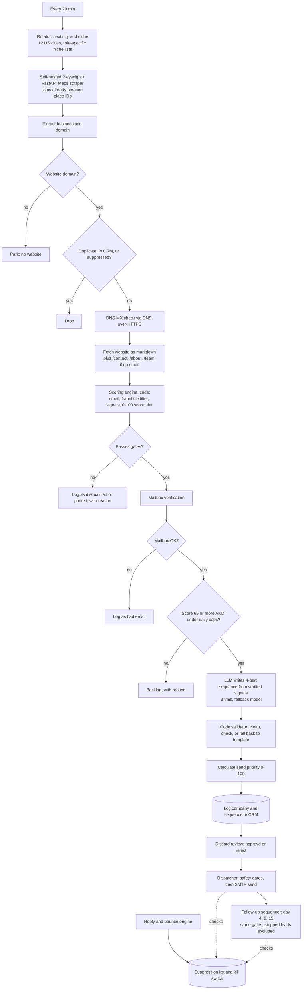

# Case Study: Autonomous Lead Generation and Outreach Engine

**A self-hosted n8n system that finds local businesses, decides which are worth contacting before spending anything on AI, drafts outreach that code checks before a human sees it, and runs approval, sending, follow-ups and reply handling with safety gates at every step.**

    

| | |
|---|---|
| **Type** | Personal build, self-hosted on my own cloud server. Built to prospect for my own services. |
| **My role** | Sole designer and builder: scraper customisation, scoring model, prompt and validation design, approval, sequencing and safety controls |
| **Scale** | 5 workflows: the lead engine (41 nodes), a dispatcher with Discord review (24), a follow-up sequencer (19), a reply and bounce engine (19) and an inbound contact triage (9) |
| **Stack** | n8n, Playwright + FastAPI (self-hosted Maps scraper), Airtable, Discord, Gmail SMTP and IMAP, OpenAI-compatible LLM endpoints, Jina reader, DNS over HTTPS, a mailbox verification API |
| **Status** | Tested end to end on synthetic leads with a self-hosted model: 100 engine runs and a 21-day outreach simulation (results below). Not yet run on real prospects; no email has been sent to a prospect. |

---

## The problem

Finding clients is the part of freelancing nobody wants to do and everybody has to. Doing it by hand is slow; doing it with a naive scraper plus ChatGPT produces spam: duplicates, dead addresses, generic emails to businesses that were never a fit, and a model bill that grows with every lead whether it deserves it or not.

A good prospecting system has to do four things most "AI outreach" tools skip: **filter hard before spending money, write only from facts it actually found, keep a human in control of every send, and make stopping easy.**

## What it does

- Finds local businesses on a schedule, one city and niche at a time, through a **scraper I host myself**.
- Throws away duplicates, already-contacted companies and anything on the suppression list, then checks that the domain can receive mail.
- Reads each company's website (and its contact pages when the homepage has no email), extracts **verifiable signals**, and scores the lead 0-100 with deterministic code.
- Verifies the mailbox before a lead can be drafted.
- Only leads above the score floor, and only up to a **daily cap**, reach the LLM. The model writes a four-part sequence from a menu of detected facts, and **code validates the draft**; a draft that fails falls back to a safe template and is flagged for review.
- A human approves or rejects from Discord. A dispatcher sends approved drafts, and a sequencer sends the follow-ups, both inside the recipient's local office hours.
- Replies and bounces are classified; opt-outs and bounces feed a suppression list that both senders check again at send time, and a bounce trips a shared kill switch.

---

## Architecture



### Stage by stage

| # | Stage | What it does | Why it is built this way |
|---|---|---|---|
| 1 | **Rotator** | Advances a persistent counter through every city and niche combination; the niche list depends on the service being sold. | Coverage without repeating, and it survives restarts because the counter is stored workflow state. |
| 2 | **Scraper service** | A Playwright/FastAPI service I customised from an open-source scraper so it accepts a list of place IDs to skip. | Without it, every run re-scrapes places already processed, wasting time and risking blocks. |
| 3 | **Filters** | A usable website domain; duplicates checked against the CRM, within the batch and against the suppression list; DNS MX lookup confirms the domain accepts mail. | All free. They remove the leads that cannot succeed before anything costs money. |
| 4 | **Website signals and scoring** | Fetches the site as markdown, tries contact pages when the homepage has no email, and runs a code scoring engine (details below). | Deterministic, explainable, cheap, and tunable without touching a prompt. |
| 5 | **Mailbox check** | Qualified leads go through a mailbox verification API. Valid and role addresses pass; invalid, disposable, catch-all and unknown results are logged and not drafted. | MX proves a domain takes mail, not that a person exists. |
| 6 | **Cap and route** | Score of at least 65, then daily draft caps per tier, with a second hosted model taking the overflow within its own daily and monthly caps. Everything else is parked as backlog with the reason. | A hard ceiling on model spend and on daily volume. |
| 7 | **Drafting** | The model returns a strict JSON object: a chosen signal, the evidence for it, a proof point, a subject, an email and three follow-ups. The call retries three times before falling back. | Forces the model to ground the email in something real. |
| 8 | **Validate** | Code normalises the draft (lowercase subject, no dashes or exclamation marks), checks keys, word counts and banned phrases, and swaps in a safe template flagged for review if anything fails. | Models drift. Output that reaches a human has been mechanically checked. |
| 9 | **Prioritise and log** | Computes a send priority and writes the company and the whole sequence to Airtable. | The human reviews the best leads first. |
| 10 | **Review** | Discord approve/reject links; a nightly approval deck. Only approved drafts can send. | Nothing is sent without a person saying yes. |
| 11 | **Dispatch** | Every 25 minutes: kill switch, daily caps, random gaps, office hours, suppression and email checks, then SMTP. | Pacing and checks happen at send time, not only at draft time. |
| 12 | **Follow-ups** | Touches on day 4, 9 and 15, with the same checks, only for leads still in good standing. | Polite timing and an emergency stop. |

---

## Deep dives

### The scoring engine is code on purpose

The score comes from a Code node, not a model. It extracts an email from the page (preferring a named, direct address over generic ones like `info@` or `contact@`), strips legal suffixes from the business name, rejects national franchises by name, and awards points in four groups: fit (25), reach (20), timing (10) and capability gap (45). The gap points come from observable signals such as a detected CRM or automation platform, a manual contact form with no connected CRM, a booking calendar, review volume, active hiring and the industry. Each contributing signal is recorded, so every score is explainable. Leads become **Tier A (80 and above)** or **Tier B (65 to 79)**; below 65 they are parked.

Hard gates run alongside the score: closed businesses, no contact email, no valid mail server, a review-count floor and national chains each disqualify a lead with a recorded reason.

Why code instead of an LLM: it is free, fast, repeatable, and when it is wrong I can see which rule to change.

### Grounded drafting

The drafting prompt does not say "write a good email". It supplies a *menu* of verified signals and a list of proof points, and requires this output:

```jsonc
{
  "chosen_signal": "key of a signal from the menu (e.g. booking_flow, intake_form, tech_crm)",
  "hook_evidence": "the exact fact used in paragraph 1",
  "proof_used":    "the proof point used in paragraph 2",
  "subject":       "3 to 8 words, lowercase",
  "email_1":       "initial 3-paragraph email",
  "followup_1":    "day 4",
  "followup_2":    "day 9",
  "followup_3":    "day 15"
}
```

The prompt carries a hard-rule list: first person, one fixed way to introduce myself, no dashes, no exclamation marks, no emojis, a banned-words list (the clichés of cold email), and the CTA offers a small, concrete piece of work rather than a call.

### The validator

After drafting, a Code node cleans and checks the result, and the checks are mechanical:

- All eight keys present and non-empty.
- Word-count bounds for every email and follow-up.
- Em and en dashes and exclamation marks are removed deterministically.
- A banned-phrase list (the clichés of cold email) is enforced.

If a draft fails, the node substitutes a safe template that uses only facts the scraper detected and marks the lead as needing review, so nothing unchecked reaches a human as if it were clean.

### Send safety

Sending is where the safety work concentrates. Both the dispatcher and the sequencer, at the moment of sending:

- read a **shared kill switch** and **fail closed**: unreachable or paused means nothing sends;
- stop at a **shared daily cap** of 10 across first touches and follow-ups (the dispatcher also keeps its own cap of 6 first touches);
- re-check the **suppression list** by domain, so an opt-out recorded after drafting still wins;
- send only inside **local office hours** (Monday to Friday, 09:00 to 17:00) for the recipient's own time zone (simulated across 10 time zones);
- lock the draft before sending and **restore it if the send fails**, so a failed touch retries on the next cycle instead of being lost.

The sequencer also excludes leads that have replied, opted out or bounced *before* it picks the next candidates, so a stopped lead can never block the queue.

### Reply handling

The reply engine watches the mailbox and sorts each message into a bounce, a delay notice, an out-of-office reply, an opt-out, an unsolicited message or a human reply. Opt-out keywords and permanent bounces act immediately, without the model. Everything else goes to an LLM classifier (positive interest, hard negative, timing objection, referral, question), and a hard negative is treated as an opt-out. Replies are matched to the CRM by sender email, then sender domain, then the reply subject, so someone who answers from a different address still suppresses the right company. A permanent bounce also trips the shared kill switch.

### Send priority

Reviewing everything equally wastes the reviewer's time, so each draft gets a 0-100 priority: roughly a third from the fit score, plus points for a direct (rather than generic) address, plus points for how strong the chosen hook is, plus a small bonus for a verified mail server; minus penalties for needing review, for markets I am less able to serve, and for very large businesses likely to ignore a cold email.

---

## Decision log

### Decision 1: score with code, draft with a model
- Scoring runs on every lead; drafting only on the best. Putting the cheap, explainable step first means model spend tracks lead quality. Cost: the scoring heuristics are proxies and need calibration against real replies.

### Decision 2: a menu of verified signals instead of free-form personalisation
- It keeps the email anchored to facts the scraper actually saw. Cost: emails are limited to what the scraper can detect.

### Decision 3: validate in code and fall back, instead of one perfect prompt
- A mechanical check plus a safe template means a weak or rate-limited model degrades the quality of a draft, never the safety of the output. Cost: a flagged template is plainer than a good draft.

### Decision 4: host the scraper myself
- Control over rate and a modification the off-the-shelf tool lacked (skip already-scraped places). Cost: I run and maintain a service, and scraping Maps carries terms-of-service risk, which is why interval and result caps are conservative.

### Decision 5: human approval, a kill switch and send-time checks before any sending
- Reputation damage from a bad send is permanent; a missing feature is not. Checks that run at send time catch anything that changed after the draft was written.

### Decision 6: simulate the whole outreach side before sending anything
- The dispatcher, sequencer and reply engine were run against a simulated clock with a stub in place of the mail sender, so the gates could be tested at scale without email going to anyone.

---

## Failure modes I designed for

| What goes wrong | What happens |
|---|---|
| Same business scraped twice | Skipped by place ID at the scraper, then by domain against the CRM and suppression list |
| No website or no email found | Parked with a reason instead of being re-scraped every cycle |
| Domain cannot receive mail, or the mailbox is invalid | Disqualified before any drafting |
| National franchise or closed business | Excluded by the scoring engine |
| Model breaks a formatting or content rule | The validator swaps in a safe template and flags it for review |
| LLM rate limit or error | Three tries, then the second hosted model, then the template |
| Daily draft cap reached | Lead parked as backlog with the reason |
| Opt-out reply, from any address | Domain suppressed; both senders re-check at send time |
| Bounce detected | Address suppressed and the shared kill switch pauses all sending |
| Kill switch unreachable | Senders fail closed and do nothing |
| Send fails | The touch is restored and retried on the next cycle |
| Recipient outside office hours | The send waits for the next cycle |

---

## Testing and verification

I tested the engine on synthetic data with a self-hosted open-weight model, so the runs used no paid API quota and sent no email to anyone. The scraper, website fetch, DNS lookup, mailbox verifier, CRM and chat notifications were replaced with fixtures; the scoring, filtering, validation, assembly, scheduling and safety logic is the exact code from the workflows.

### Lead engine: 100 runs, 300 synthetic leads

Leads were spread across 16 cities in four countries (to exercise time-zone handling) and 13 niches, including no-website, social-only, franchise, closed-business, duplicate, already-suppressed, bad-mailbox and low-review cases.

| Check | Result |
|---|---|
| Workflow runs completed | 100 of 100 |
| Leads accounted for (270 with a recorded outcome, 30 removed as duplicates) | 300 of 300 |
| Drafts produced with the footer, opt-out line and postal address | 62 of 62 |
| Median run time, 3 leads per run | about 37 s |
| Median draft time on a small CPU-only VM | about 45 s |
| Paid API calls used | 0 |

Every lead ends in exactly one state: drafted, disqualified, parked (no website or no email yet), rejected for a failed mailbox check, or backlogged by the daily cap. Gates exercised: national chains, closed businesses, missing mail server, review-count floor, missing contact email and mailbox status.

### Outreach safety: 21 simulated days

I ran the dispatcher, follow-up sequencer and reply engine against a simulated clock with a stubbed sender: 1,209 dispatcher cycles and 1,008 sequencer cycles, 60 leads in 18 cities across 10 time zones, and 57 inbound events (opt-outs, hard bounces, delay notices, out-of-office replies, unsolicited mail and human replies). The kill switch was made unreachable for 14 hours and paused by hand once.

| Check | Result |
|---|---|
| Stub sends (45 first touches, 23 follow-ups) | 68 |
| Sends to a suppressed domain after suppression | 0 |
| Sends outside 09:00 to 17:00 local, Monday to Friday | 0 |
| Days over the shared 10-per-day cap | 0 |
| Sends while the kill switch was paused or unreachable | 0 |
| Opt-outs and bounces that suppressed the right domain | 20 of 20 |
| Hard bounces that tripped the shared kill switch | 5 of 5 |
| Failed sends retried on the next cycle (25% forced failure rate) | 9 of 9 |
| Human replies classified to the right intent (self-hosted model) | 26 of 28 |

The numbers come from synthetic leads, so they show that the logic behaves as designed, not what a live campaign would return.

---

## Configuration and swap-ins

Everything below is a setting or a node swap, not a rewrite. The defaults are what I used because they are free or cheapest, not because the design needs them.

| What | Default here | Change it to |
|---|---|---|
| **Drafting LLM** | An OpenAI-compatible hosted model, with a second hosted model as overflow and fallback | Any OpenAI-compatible endpoint, OpenAI, Anthropic, Gemini, or a local model. The validator makes weaker models usable and stronger ones fall back less. |
| **Daily draft caps** | 25 Tier A and 20 Tier B on the primary model; 15 per day and 300 per month on the fallback | Any numbers. They are constants in the cap node. |
| **Tier thresholds** | Tier A at 80, Tier B at 65, below 65 parked | Any. |
| **Scoring weights and signals** | Gap signals such as CRM detected, manual form, booking calendar, review volume, hiring | Add, remove or reweight signals for your own offer. |
| **Cities and niches** | 12 US cities, role-specific niche lists in the rotator | Edit the arrays. |
| **Offer, voice and proof points** | My services and writing style in the Config node | Your own. This is the part that makes it yours. |
| **Scraper** | Self-hosted Playwright/FastAPI service | Apify, Outscraper, SerpAPI, Google Places API, a purchased list. Anything that returns name, website and place ID. |
| **Mailbox verification** | A verification API | Any verifier that returns a status per address. |
| **Review and notification channel** | Discord | Slack, email or Telegram. |
| **Sender and mailbox** | Gmail SMTP and IMAP | Any SMTP or API sender and any IMAP inbox. |
| **Send caps, cadence and office hours** | 6 first touches and 10 total per day, day 4/9/15, 09:00 to 17:00 local | Any. |
| **CRM** | Airtable | Sheets, Notion, Postgres, HubSpot. |

## What this demonstrates

- **Cost-aware pipeline design**: free filters, deterministic scoring, a mailbox check, then a capped LLM step.
- **Guard-railed LLM output**: grounding, mechanical validation and a safe fallback.
- **Backend integration**: customising and self-hosting an open-source scraper service and wiring it to n8n.
- **Safe-by-default outreach**: approval gate, shared caps, office-hours gating, send-time suppression checks and a fail-closed kill switch.
- **Testing without side effects**: a simulated clock, a stubbed sender and synthetic events to exercise the safety logic at scale.

## Repository

| File | Purpose |
|---|---|
| [`workflows/01-lead-engine-and-outreach-crm.json`](workflows/01-lead-engine-and-outreach-crm.json) | Rotate, scrape, filter, score, verify, draft, validate, log (41 nodes) |
| [`workflows/02-dispatcher-discord-review.json`](workflows/02-dispatcher-discord-review.json) | Approval queue, safety gates, SMTP send, nightly approval deck (24 nodes) |
| [`workflows/03-multi-touch-followup-sequencer.json`](workflows/03-multi-touch-followup-sequencer.json) | Day 4/9/15 follow-ups, shared gates, stopped leads excluded, failed sends retried (19 nodes) |
| [`workflows/04-reply-and-bounce-engine.json`](workflows/04-reply-and-bounce-engine.json) | Mailbox watcher, reply intent, opt-out and bounce suppression, kill switch (19 nodes) |
| [`workflows/05-portfolio-inbound-triage.json`](workflows/05-portfolio-inbound-triage.json) | Inbound contact webhook, CRM match, alert (9 nodes) |

### Run it yourself
1. Import the workflows into n8n. All are exported **inactive**.
2. Replace every placeholder (`REPLACE_ME`, `YOUR_*`, `WORKFLOW_ID_*`, `your-sender`) and re-select credentials. The Config node holds the sender profile and Airtable table names; set your own sender identity and postal address.
3. Deploy the Maps scraper service and point the HTTP node at it (host names in the export are internal Docker names), and deploy the small bot that serves the shared kill switch and the Discord approval links.
4. Create the Airtable tables (companies/CRM, outreach drafts, suppression).
5. Keep everything **inactive** until you have tested with your own addresses.

### Responsible use
Scraping Google Maps may violate Google's terms, and cold email is regulated. Keep interval and result caps low, honour opt-outs, include a real postal address, and check CAN-SPAM, GDPR and PECR for your jurisdiction. This documents a pipeline design; it is not an invitation to send unsolicited bulk mail. Do not use a shared sandbox or testing-only sending service for outreach.

MIT licensed.
